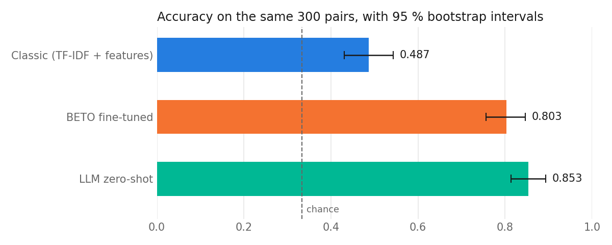
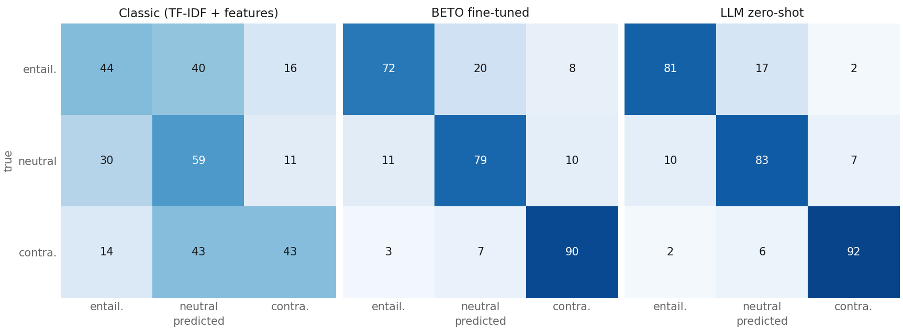

# Spanish Natural Language Inference, three ways

Given a premise and a hypothesis, does the first **entail** the second, **contradict** it, or neither (**neutral**)?

> Premise: *El tren salió de la estación a las ocho.*
> Hypothesis: *El tren todavía no se fue.* → contradiction

This repository compares three generations of NLP on that task, on the Spanish part of
[XNLI](https://github.com/facebookresearch/XNLI), with the same test pairs and the same metrics:

1. a linear classifier on handcrafted lexical features,
2. a fine-tuned Spanish BERT ([BETO](https://github.com/dccuchile/beto)),
3. a large language model prompted zero-shot.

## Results

300 test pairs, 100 per class (chance is 0.333).

| Approach | Accuracy (95 % CI) | Macro F1 | Training | Inference |
|---|---|---|---|---|
| TF-IDF cosine + 6 features, logistic regression | 0.487 (0.430 to 0.543) | 0.487 | minutes on CPU | trivial |
| BETO fine-tuned on XNLI train | 0.803 (0.757 to 0.847) | 0.802 | about 3 h on one GPU | cheap |
| Claude Haiku, zero-shot | **0.853** (0.813 to 0.893) | **0.854** | none | a model call per batch |



### How much of this ranking is solid?

| Comparison | Difference in accuracy (95 % CI) | Pairs only one gets right | Exact McNemar p |
|---|---|---|---|
| BETO vs classic | +0.317 (0.253 to 0.380) | 111 vs 16 | < 1e-17 |
| LLM vs classic | +0.367 (0.297 to 0.433) | 131 vs 21 | < 1e-19 |
| LLM vs BETO | +0.050 (-0.003 to 0.103) | 41 vs 26 | 0.086 |

Both neural approaches are far ahead of the lexical one. **The 5 point gap between the LLM and BETO is not
statistically clear on 300 pairs**: the interval includes zero. It should be read as "the LLM was at least on par with a
fine-tuned encoder without using any training data", not as a settled ranking.

### Where they fail



- **Neutral is the hardest class** for BETO and the LLM, and contradiction the easiest (F1 0.87 and 0.92).
- Only **12 of the 300 pairs** defeat all three approaches, and 288 are solved by at least one.
- BETO and the LLM agree on 228 pairs and are right on 215 of those (94 %). A three-way majority vote gets 252, below
  the LLM alone (256), so combining them this way does not help.
- The LLM's accuracy ranged from 0.77 to 0.97 across its ten batches of 30 (BETO on the same batches: 0.70 to 0.90),
  a reminder of how noisy 30 examples are.

Slices by negation words and by word overlap are in [results/slices.csv](results/slices.csv). They are small and the
class mix differs between slices, so treat them as exploratory.

## The classical model barely uses the premise

Two variants were added to probe the baseline. All three use the same logistic regression on 392,702 training pairs.

| Variant | 300 pairs | All 7,500 pairs |
|---|---|---|
| Cosine + 6 overlap, negation and length features (original) | 0.487 | 0.507 |
| TF-IDF of the **hypothesis only**, premise never read | 0.567 | 0.555 |
| Both together | 0.553 | 0.580 |

A model that never sees the premise beats the one designed to compare the two sentences. This is the well-known
annotation artifact of crowd-written NLI data: the wording of a hypothesis already hints at its label
([Gururangan et al., 2018](https://aclanthology.org/N18-2017/); [Poliak et al., 2018](https://aclanthology.org/S18-2023/)).
Any score on this task should be compared with that 0.55, not with 0.33.

## Data

[XNLI](https://aclanthology.org/D18-1269/) (Conneau et al., 2018), Spanish configuration:

- **train**: 392,702 pairs, MultiNLI machine translated into Spanish,
- **evaluation**: 7,500 pairs (5,010 test and 2,490 validation).

The 300-pair sample takes 100 pairs per class from those 7,500 with seed 42 (202 come from test, 98 from validation).
No model was tuned on them: BETO's early stopping used 2,000 pairs held out of train.

XNLI is released under [CC BY-NC 4.0](https://creativecommons.org/licenses/by-nc/4.0/). **Its sentences are not copied
here.** The repository stores pair ids, gold labels and model predictions, and `scripts/get_data.py` downloads the
dataset and rebuilds the identical sample.

## Methods

**Classical.** TF-IDF (30,000 terms) cosine similarity between premise and hypothesis, plus word overlap, bigram
overlap, number of negation words in each sentence, length difference and length ratio. Seven numbers in total.

**Fine-tuned encoder.** `dccuchile/bert-base-spanish-wwm-cased` with a three-class head. AdamW 2e-5, batch 32,
128 tokens, 6 % warmup, early stopping with patience 3 on the held-out 2,000 pairs (best epoch 2 of 5, 0.809).

**LLM.** Claude Haiku, zero-shot, the 300 pairs without labels in 10 batches of 30. A first attempt with all 300 in a
single batch drifted to answering "neutral" most of the time (about 0.36 accuracy; I did not keep those outputs).

## Reproducing

```bash
python -m venv .venv && source .venv/bin/activate      # Windows: .venv\Scripts\activate
pip install -r requirements.txt
pytest -q                                              # no download needed
python scripts/analyze.py                              # tables and figures from the saved predictions
python scripts/get_data.py                             # downloads XNLI, rebuilds the sample
python scripts/classic.py                              # a few minutes on CPU
python scripts/train_beto.py --fp16                    # GPU
python scripts/llm_batches.py split                    # then answer the batches and run `merge`
```

What can be reproduced:

| Part | Status |
|---|---|
| 300-pair sample | rebuilt from the Hugging Face copy of XNLI, identical to the original, field by field |
| Classical approach | re-run: all 300 predictions identical to the original ones (scikit-learn 1.9.0) |
| BETO predictions | taken from a full run I did for a separate project; the checkpoint is not included. `train_beto.py` is a cleaned-up script with the same configuration, checked only with a tiny smoke run, **not** retrained in full |
| LLM predictions | saved outputs only. I did not record the exact prompt or model version, so this arm cannot be re-run identically |
| Metrics, intervals, tests, figures | regenerated from the saved predictions by `analyze.py` |

## Limitations

- 300 pairs give intervals of roughly ±4 to ±6 points.
- XNLI has been public since 2018, so the LLM may have seen these sentences or their English originals during
  pre-training. Its score may overstate how it would do on new text.
- The Spanish training data is machine translated, and some evaluation sentences contain typos.
- One seed per trained model.

## Repository layout

```
scripts/     data download, the three approaches, analysis
results/     sample ids, predictions, metrics and statistical tests
figures/     plots made by scripts/analyze.py
tests/       unit tests
```

## Background

I built this for a Natural Language Processing course at the University of Buenos Aires. I added the probes, the
statistical tests and this write-up afterwards.
